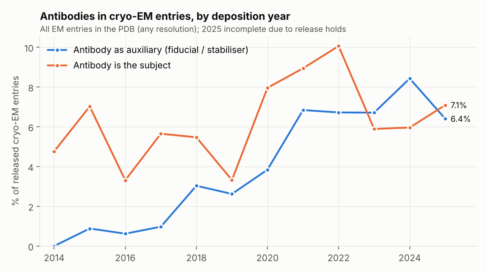
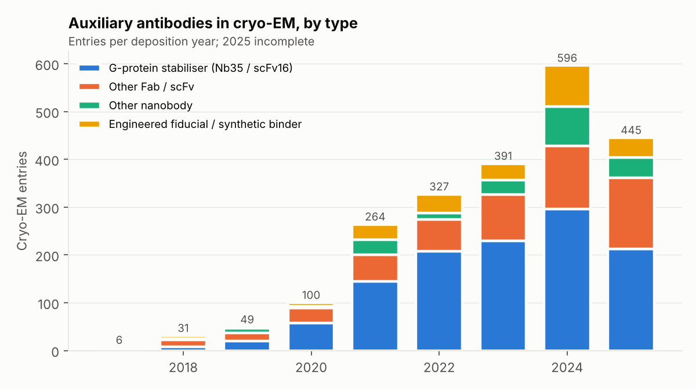
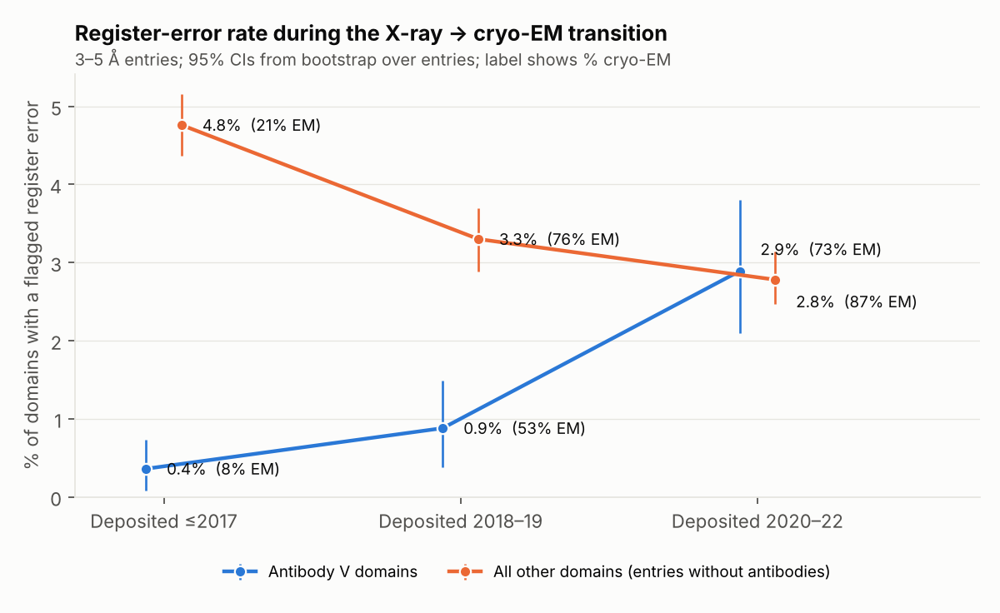
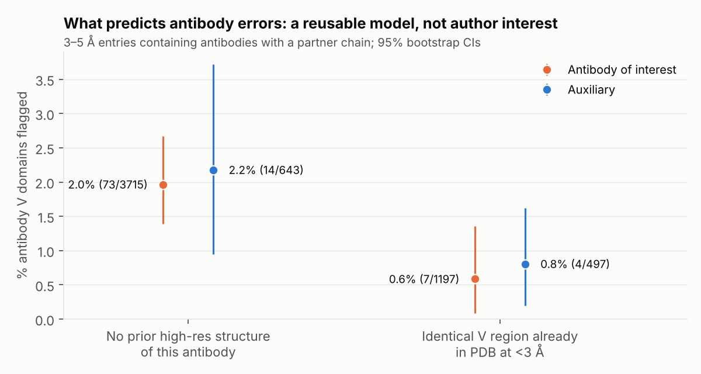

# Do authors cut corners on parts they care less about? Antibodies, cryo-EM and register errors

This follow-up builds on `../REPORT.md`. It uses the putative register errors from Sánchez Rodríguez
et al., *IUCrJ* 2024 (Table S1: X-ray and cryo-EM entries at 3–5 Å, PDB snapshot of 5 April 2022).
I joined them to ECOD domains, ANARCI antibody calls, RCSB citation and validation metadata, and
PDB-wide deposition, sequence and UniProt data.

## Summary

The hypothesis under test: under time pressure, authors model the parts they care less about less
carefully, for example an antibody used only as a fiducial. **The data do not support it. Whether an
earlier high-resolution model of the antibody already existed matters far more than the antibody's
role.**

| Question | Answer |
|---|---|
| **A.** Antibodies as cryo-EM fiducials over time | Rose from ~1% of all released cryo-EM entries (2017) to 6.4–8.4% (2021–25), and to 16–21% of membrane-protein/receptor entries. About half are the GPCR G-protein stabilisers Nb35 and scFv16. |
| **B.** Error rate during the X-ray → cryo-EM switch | Antibody V-domain flag rate rose **8-fold** (0.36% → 2.89%) while every other domain class *fell* (4.8% → 2.8%). About **46%** of the antibody rise is the shift to cryo-EM and lower resolution; **54%** happened within method and resolution (EM 0.5% → 3.4%; X-ray 0.35% → 1.5%). |
| **C.** Are antibody errors worse when the antigen is the real focus? | **No.** Auxiliary-antibody V domains 1.58% vs antibody-of-interest 1.62% (adjusted OR 0.97, 0.49–1.91). The within-entry comparison of antibody vs antigen points the other way (interaction OR 0.66, 0.29–1.51). Auxiliary antibodies are also *better* resolved and *less* clash-prone relative to their partner chains. |
| **D.** High-impact papers, structures per paper, scooping | CNS papers deposit more structures (mean 3.7 vs 2.6 entries per paper). Non-antibody domains in CNS and CNS-sister papers carry modestly more errors (adjusted OR ~1.3). There is **no robust high-impact × auxiliary-antibody effect**: an apparent OR of 38 disappeared once journal names were normalised. Novel targets and moderately contested targets carry slightly more errors. |
| **E.** Do antibody errors co-occur with errors in other chains? | **Not with the antigen**: 6 entries have both flagged vs 5.6 expected by chance (Mantel–Haenszel OR 1.09, 0.45–2.65). They do co-occur between the antibody's own heavy and light chains (OR 3.8). Across non-antibody complexes, errors in one entity predict errors in another (OR 2.4). |
| **Extras** | (i) The strongest antibody predictor is the absence of a prior high-resolution model of the same V region (OR 0.32 when one exists). (ii) Errors cluster strongly by lab (3× the dispersion expected from method, resolution, year and size). (iii) 2020 SARS-CoV-2 antibody structures had a 6.4% flag rate, but this is concentrated in a few labs and explained by poorer local map quality. (iv) Flagged entries are rarely corrected (13% vs 11% coordinate-revision rate). |

---

## Data and methods

* **Error data.** 12,674 putative register errors from Table S1. The **denominator** is the 19,558
  X-ray/EM entries at 3–5 Å that were *released* by 5 April 2022, which is the authors' snapshot:
  every flagged entry was released by 30 March 2022. The first report also counted 2,114 entries
  released after the snapshot; that is corrected here and in `../REPORT.md`.
* **Domains.** ECOD v295.2. 86% of errors fall in an ECOD domain.
* **Antibody chains.** ANARCI (IMGT, HMMER) on every unique sequence. Antibody V = V-set domain on
  an H, K or L chain. Antibody C = C1-set domain.
* **Antibody role classifier** (`scripts/abrole.py`). Rules are applied in this order:
  1. Known auxiliary reagents in the title or antibody description are classed **auxiliary**:
     Nb35, scFv16, BRIL/BAG2 Fab, NabFab, anti-Fab nanobody, megabody, legobody, sybody, sAB,
     "synthetic", "chaperone", "fiducial", ALFA/GFP nanobodies.
  2. Antibody-focus title terms are classed **antibody of interest**: neutralising, epitope, bnAb,
     germline, vaccine, therapeutic, "-mab" INN names, etc.
  3. Viral or pathogen antigens, or IMMUNE keywords without a target-protein keyword, are classed
     **antibody of interest**.
  4. A title that doesn't mention any antibody, or a target-class keyword (membrane, transport,
     enzyme…) without IMMUNE, is classed **auxiliary**.
  5. Anything else is **unclear** (2–3%, excluded).

  Hand check of a random sample: 30/30 auxiliary and 29/30 antibody-of-interest calls were correct.
  The one miss was an anti-Fab nanobody pattern, which I then added.
* **Local map quality.** Per-residue wwPDB Q-score (EM) or RSCC (X-ray) from the RCSB API, averaged
  per domain and z-scored within method. This is partly post-treatment, because a misregistered
  segment fits the map worse, so I report models with and without it.
* **Impact and competition proxies.**
  * *Journal tier.* CNS = Nature, Science, Cell. CNS sister journals = Nature-, Science- and
    Cell Press-family titles.
  * *Entries per paper.* PDB-wide count of entries sharing the primary citation.
  * *Competing groups.* Distinct other last authors depositing the same target UniProt within
    ±6 months, PDB-wide. The target is the rarest UniProt among the non-antibody chains.
  * *Novel target.* Deposited within 12 months of that UniProt's first PDB entry.
  * *Hold time.* Deposition to release.
* **Statistics.** The unit is the ECOD domain unless stated. Logistic regressions adjust for
  method × resolution bin, deposition era and log domain length, with SEs clustered by entry.
  Within-entry comparisons use conditional logistic regression (entry fixed effects). CIs are 95%,
  from bootstrap resampling over entries.

---

## A. Antibodies as cryo-EM fiducials and stabilisers over time

All 37,607 released cryo-EM entries, any resolution, by deposition year. The most recent years are
incomplete because many entries are still on hold.

| Year | EM entries | Auxiliary antibody | % of EM | % of membrane-like EM | Antibody of interest | % of EM |
|---|---|---|---|---|---|---|
| 2016 | 484 | 3 | 0.6 | 2.8 | 16 | 3.3 |
| 2017 | 619 | 6 | 1.0 | 3.8 | 35 | 5.7 |
| 2018 | 1,024 | 31 | 3.0 | 9.4 | 56 | 5.5 |
| 2019 | 1,870 | 49 | 2.6 | 7.6 | 62 | 3.3 |
| 2020 | 2,601 | 100 | 3.8 | 11.7 | 207 | 8.0 |
| 2021 | 3,860 | 264 | 6.8 | 18.2 | 345 | 8.9 |
| 2022 | 4,869 | 327 | 6.7 | 18.3 | 490 | 10.1 |
| 2023 | 5,827 | 391 | 6.7 | 16.2 | 343 | 5.9 |
| 2024 | 7,067 | 596 | 8.4 | 21.0 | 421 | 6.0 |
| 2025 | 6,949 | 445 | 6.4 | 15.7 | 493 | 7.1 |

* **GPCR G-protein stabilisers dominate.** Nb35 and scFv16 make up about 50–60% of auxiliary uses
  from 2020 onwards. These are the *same two* reagents in every entry, so a high-resolution model
  always exists to dock.
* **Engineered fiducials are a small but growing share.** BRIL-Fab, NabFab, megabodies, legobodies,
  sybodies and sABs went from 7 entries in 2020 to 85 in 2024.
* **The size-boosting use is visible in the data.** Median non-antibody mass is 127–160 kDa in
  auxiliary entries, 187 kDa when the antibody is the subject, and 278 kDa in entries without
  antibodies.
* **Auxiliary entries tend to have better resolution.** Median 3.1 Å vs 3.2–3.3 Å for EM entries
  without antibodies, 2021–24.
* **Use is spread across labs.** 2,273 auxiliary entries come from 447 different last authors.

Tables: `tables/A_em_antibody_use_by_year.csv`, `tables/A_aux_types_by_year.csv`.

## B. How much did the error rate rise across the X-ray → cryo-EM transition?

| Domain class | ≤2017 | 2018–19 | 2020–22 | % EM (≤2017 → 2020–22) |
|---|---|---|---|---|
| Antibody V | 0.36% (0.08–0.73) | 0.88% (0.38–1.49) | **2.89% (2.10–3.80)** | 8% → 73% |
| Antibody C | 0.56% | 0.47% | 0.81% | 2% → 51% |
| Non-antibody, in antibody entries | 2.57% | 3.13% | 2.29% | 12% → 82% |
| Non-antibody, other entries | 4.76% (4.37–5.16) | 3.30% | **2.78% (2.47–3.14)** | 21% → 87% |

The table below splits each change from ≤2017 to 2020–22 into two parts. The composition part is
the change explained by the shift in method and resolution, estimated by holding 2020–22
within-stratum rates at the ≤2017 mix. The remainder is the within-stratum change.

| | ≤2017 | 2020–22 | Change | Within method × resolution | Composition |
|---|---|---|---|---|---|
| Antibody V | 0.36% | 2.89% | **+2.53 pp** | +1.36 pp (54%) | +1.17 pp (46%) |
| Non-antibody, other entries | 4.76% | 2.78% | −1.98 pp | −2.00 pp | +0.02 pp |

* The X-ray → EM shift explains about half of the antibody increase. The rest is a genuine rise
  within both methods: EM antibody V went from 0.48% to 3.42%, and X-ray from 0.35% to 1.47%.
* Every other fold improved over the same period. By 2020–22 antibody V domains were flagged *more*
  often than other domains, after adjustment (OR 1.45, 1.01–2.07). In ≤2017 they were flagged 12×
  *less* often (OR 0.08).
* The study's data end in early 2022, so I can't tell whether the trend continued.

Tables: `tables/B_*.csv`.

## C. Are antibody errors more frequent when the antibody is only an auxiliary?

The 3–5 Å entries with antibodies plus a partner chain split into 461 auxiliary entries (267 EM,
194 X-ray) and 1,039 antibody-of-interest entries (509 EM, 530 X-ray).

| % domains flagged (95% CI) | Antibody V | Antibody C | Non-antibody (antigen/target) |
|---|---|---|---|
| Antibody of interest | 1.62 (1.15–2.15) | 0.70 | 1.96 (1.20–2.91) |
| Auxiliary | 1.58 (0.93–2.45) | 0.36 | **3.55 (2.49–4.74)** |
| Auxiliary, G-protein stabilisers only | **0.00 (0/177)** | – | 4.26 |
| Auxiliary, all other | 1.87 | 0.36 | 3.26 |

* **Antibody V, auxiliary vs of-interest.** Adjusted OR 0.97 (0.49–1.91). Adding local quality
  gives 1.41 (0.74–2.69). Neither is significant.
* **Difference-in-differences.** This compares the antibody's error rate relative to its own
  partner chain in auxiliary vs of-interest entries. The interaction OR is 0.66 (0.29–1.51), or
  0.82 with local quality. The within-entry conditional logit gives 0.72 (0.35–1.48). All point
  *against* the hypothesis, though the CIs are wide.
* **Auxiliary antibodies are better resolved, not worse.** Mean EM Q-score z for antibody V is
  +0.50 in auxiliary entries vs −0.30 when the antibody is the subject. Fiducials are selected for
  rigid binding, while antibodies of interest often bind flexible viral glycoproteins.
* **Clash fraction also goes the wrong way for the hypothesis.** In antibody-of-interest entries,
  antibody chains have 1.1 pp more clashing residues than their partner chains (p < 10⁻⁵). In
  auxiliary entries that excess disappears (−1.1 pp, p = 0.007). Angle outliers show no role
  difference.
* **Modelling effort looks the same either way.** About 25% of EM antibody chains have a modelled
  constant domain in both groups, so Fv-only modelling is equally common whether or not the
  antibody is the subject.
* **In auxiliary entries it is the *target* that carries more errors** (3.55% vs 1.96%). Those
  targets are mostly α-helical membrane proteins, which are among the most error-prone folds (see
  `../REPORT.md`).

### The prior high-resolution template matters more than the antibody's role

I checked whether an identical V region (first 105 residues) had been deposited in the PDB at
< 3 Å before the entry's deposition date.

* **Auxiliary antibodies are more often re-used models.** 44% have such a template, vs 24% of
  antibodies of interest.
* **Without a template, the roles look alike:** auxiliary 2.2% (14/643) vs of-interest 2.0%
  (73/3,715).
* **With a template, both drop:** auxiliary 0.8% (4/497) vs of-interest 0.6% (7/1,197).
* **Adjusted, the template is what counts:** template OR 0.32 (0.14–0.76), auxiliary role OR 1.12
  (0.57–2.19).

So errors arise when an antibody is built *de novo* into a 3–5 Å map, whatever the authors' interest
in it. This also explains the 0/177 rate for Nb35/scFv16, which are always docked from existing
models.

Tables: `tables/C_*.csv`, `tables/X5_prior_template.csv`, `tables/fig4_table.csv`.

## D. High-impact journals, structures per paper and scooping pressure

**Structures per paper.** PDB-wide, papers published 2015–25:

| Tier | Papers | Mean entries/paper | 90th percentile |
|---|---|---|---|
| CNS | 2,406 | 3.70 | 7 |
| CNS sister journals | 9,951 | 3.27 | 6 |
| Other journals | 31,322 | 2.55 | 5 |

Restricted to EM-majority papers: CNS 3.69, sister journals 3.25, others 2.46. So high-impact papers
do deposit more structures. But more entries per paper goes with slightly *fewer* errors per
structure: OR 0.92 (0.86–0.98) per doubling for non-antibody domains, and n.s. for antibody V.

**Error rate by journal tier.** Adjusted ORs vs other journals:

| | CNS | CNS sister | Unpublished |
|---|---|---|---|
| Non-antibody domains | **1.28 (1.08–1.51)** | **1.29 (1.09–1.52)** | 0.58 (0.42–0.80) |
| Antibody V | 1.24 (0.63–2.47) | 1.49 (0.81–2.74) | 0.75 |
| High-impact × auxiliary (antibody domains) | interaction OR 1.09 (0.28–4.30) | | |

The paper-level comparison is not significant either:
* Auxiliary-antibody papers with ≥ 1 flagged antibody domain: 9/178 high-impact vs 1/90 other
  (Fisher p = 0.17).
* Antibody-of-interest papers: 25/345 vs 15/296 (p = 0.33).

**Caution.** An earlier version of the tier definition put PNAS, eLife and EMBO J in the high tier
and left unnormalised abbreviations such as "Nat.Struct.Mol.Biol." in "other". That version produced
a high-impact × auxiliary interaction OR of 38 (p = 0.001). It was driven by four entries from one
eLife paper and collapsed once tiers were defined cleanly. Treat any claim of this kind as fragile.

**Competition and novelty.** Multivariable model with tier, entries per paper, hold time, novelty and
competition, plus the standard covariates:

| | Non-antibody domains | Antibody V | Antibody V excluding SARS-CoV-2 |
|---|---|---|---|
| 1–2 other groups on same target within ±6 mo | **1.28 (1.10–1.48)** | 0.24 (0.09–0.69) | 0.22 |
| 3–9 other groups | **1.36 (1.12–1.66)** | 0.42 (0.10–1.75) | 0.41 |
| ≥ 10 other groups | 0.98 (0.60–1.61) | 1.62 (0.83–3.14) | no events |
| Novel target (first year in PDB) | **1.23 (1.08–1.40)** | **2.09 (1.21–3.61)** | 1.81 (0.84–3.88) |
| CNS (vs other journal) | **1.39 (1.18–1.63)** | 1.07 | **2.41 (1.03–5.61)** |
| Hold time > 1 year (vs 91–180 d) | **2.48 (2.05–3.00)** | 0.96 | 0.96 |

* **Non-antibody domains** show the pattern the scooping hypothesis predicts: novel targets,
  moderately contested targets and CNS papers carry ~25–40% higher odds of a flagged error. These
  effects are modest. The largest effect is long-held entries (> 1 year), which mostly reflects
  older, slower X-ray projects.
* **For antibody V domains** the novelty and crowding signals are almost entirely SARS-CoV-2.

**SARS-CoV-2 natural experiment.** Antibody-of-interest entries against viral antigens; antibody V
flag rates:

| | ≤2019 | 2020 | 2021–22 |
|---|---|---|---|
| SARS-CoV-2 | – | **6.40% (31/484)** | 2.87% |
| Other viruses | 0.68% | 1.39% | 1.54% |

The 2020 SARS-CoV-2 spike looks like a time-pressure effect, but three things qualify it:
* **It is concentrated.** The 31 flagged domains are in 13 entries from 5 labs, and 7 of those
  entries are from one group, out of 107 entries and 40 labs.
* **The maps were worse locally.** Mean local quality z was −0.78 vs +0.11 for other-virus antibody
  complexes in 2020.
* **It isn't significant once adjusted.** After method, resolution and length the SARS-CoV-2 × 2020
  interaction OR is 2.13 (0.47–9.7); with local quality, 1.88 (0.45–7.9).

Antibody domains in crowded (≥ 3 competing groups) auxiliary entries had **0** flags.

Tables: `tables/D1_*.csv`, `tables/D2_*.csv`, `tables/D3_*.csv`.

## E. When an antibody has an error, do other chains in the complex?

Unit: entries with antibodies plus a partner (n = 1,340). "Flagged" means any chain of that entity
has an error.

| | Antigen clean | Antigen flagged |
|---|---|---|
| Antibody clean | 1,184 | 99 |
| Antibody flagged | 51 | **6** |

* **Antibody and antigen errors don't co-occur.** P(antigen flagged | antibody flagged) = 10.5% vs
  7.7%. Mantel–Haenszel OR across method × resolution strata = 1.09 (0.45–2.65). A permutation
  within strata expects 5.6 entries with both flagged; 6 were observed (p = 0.51).
* **The pattern is the same for both roles.** Auxiliary: 7.1% vs 12.3%. Of interest: 7.7% vs 4.9%.
* **Within the antibody, errors do co-occur.** Heavy/light partner: OR 3.8 (1.6–9.1).
* **Across non-antibody complexes they co-occur too.** An error in one entity predicts an error in
  another: OR 2.42 (2.14–2.72).

So antibody errors look *local to the antibody*, typically one de novo-built Fv. They don't reflect
a sloppy entry overall, which is what you would expect if rushing were the main driver.

## Additional analyses

* **Lab-level clustering.** I fitted an entry-level model (any flagged chain ~ method × resolution
  + era + size) to 873 labs with ≥ 5 entries (11,862 entries). Observed between-lab dispersion is
  **3.0×** the simulated expectation (95% sim range 0.90–1.12, p < 0.002). The 10% of labs with the
  highest observed/expected ratio hold 18% of flagged entries, against 4% expected. Lab practice is
  a much stronger signal than journal or role.
* **Errors are rarely fixed.** 13.2% of flagged entries later had a coordinate ("Atomic model")
  revision, vs 10.7% of unflagged entries.
* **Fold-class results** from the first report hold on the corrected denominator
  (`../table_raw.csv`, `../table_adjusted_vs_abV.csv`).

## Interpretation

The evidence is most consistent with this explanation:

1. **Antibody register errors are a building problem.** They appear when a new Fv is built into a
   3–5 Å map, often at a flexible, poorly resolved periphery. They are rare when a high-resolution
   model can be docked. The X-ray → EM shift plus the 2020–22 surge in new antibodies of interest
   (SARS-CoV-2, HIV) raised antibody error rates while other folds improved.
2. **Author "interest" doesn't show up as a measurable driver.** Auxiliary antibodies are, if
   anything, modelled no worse than antibodies of interest. Their apparent advantage disappears
   once template availability is accounted for.
3. **Weak evidence for scooping pressure, outside antibodies.** In non-antibody domains, errors rise
   modestly for high-impact journals, novel targets and contested targets (ORs ~1.2–1.4). That is
   consistent with time pressure, but also with harder or newer projects.
4. **The largest non-technical factor is the lab, not the journal.**

## Limitations

* **The flags are predictions.** Errors are conkit-validate predictions (about 87% confirmed where a
  high-resolution comparison exists). Sensitivity may differ by fold.
* **Few events.** Only ~110 antibody V domains are flagged. The role and impact comparisons have
  wide CIs, so a modest real effect (OR ≤ 2) could be missed.
* **The data stop in April 2022.** Error rates for the 2023–26 fiducial boom (Part A) are unknown.
* **Role classification is heuristic**, though about 97% accurate on a hand-checked sample. "Author
  interest" is inferred from titles and keywords, not measured.
* **The proxies are crude.** Journal tier, competition and novelty are proxies, and the
  last-author-as-lab assumption is imperfect.
* **Local quality is partly post-treatment.** Q-score and RSCC are affected by the errors
  themselves, so I report models with and without it.
* **Correlation only.** Labs, targets and journals differ in many unmeasured ways.

## Files

* **`figures/`** — four PNGs.
* **`tables/`** — every result table as CSV, plus the full logs (`partBC.log`, `partDE.log`,
  `prior.log`).
* **`scripts/`** — the pipeline, in order:
  * data pulls: `gql_meta2.py`, `gql_em.py`, `gql_local.py`, `gql_cite_all.py`
  * antibody calls and roles: `run_anarci2.py`, `abrole.py`, `classify_sets.py`
  * Part A: `partA.py`
  * integrated tables: `build2.py`, `local_q.py`
  * Parts B–C: `partBE.py`
  * Parts D–E and extras: `partD.py` (with `tiers.py`)
  * prior templates: `prior_template.py`
  * charts: `figures.py`

  The first-report scripts in `../scripts/` build the chain, domain and error tables used here.
  After `build2.py`, `filter_released.py` restricts the denominator to entries released by
  2022-04-05.
* **Inputs** (re-downloaded by the scripts): Table S1; ECOD v295.2; RCSB Search, GraphQL and
  validation features; wwPDB `entries.idx` and `pdb_seqres.txt`; SIFTS `pdb_chain_uniprot`.
  Queried 2026-11-01.
